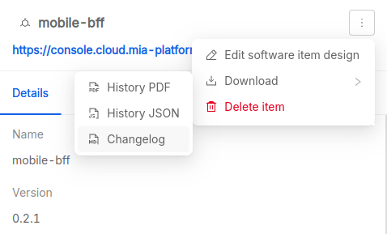
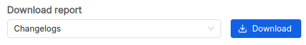
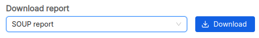
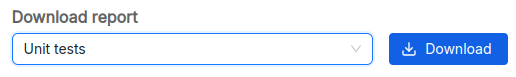

# Reports

**Mia-Care P4SaMD** can automatically generate documentation from managed entities such as [risks][risks], requirements, [tests][tests] and [changes][changes]. The generated documents cover the most common documentation requirements outlined in international regulation and standards related to SaMD development.

The sections below describe the documentation P4SaMD generates by default, how to generate it and what it contains. You can also generate additional documentation from custom templates.

:::warning

Documentation completeness and correctness depend on correct and updated information available in the integrated ALM.
If ALM information is missing, incorrect or outdated, the generated documentation may not be generated correctly, lack relevant information or include incorrect or outdated information.

:::

## Default templates

- [SOUP Report](#soup-report)
- [Changelogs](#changelogs)
- [Unit Test report](#unit-test-report)
- [Vulnerability Report](#vulnerability-report)
- [Software Architecture Design](#software-architecture-design)

## Startup package of customizable templates
- [Release Note](#release-notes)
- [Acceptance Test Report](#acceptance-test-report)
- [Verbale collaudo](#verbale-di-collaudo)
- [Traceability Matrix](#traceability-matrix)
- [Change Request Report](#change-request-report)
- [Software Architecture Description](#software-architecture-description)
- [Risk Management Report](#risk-management-report)

## Changelogs

With Mia-Care P4SaMD you can download changelogs of software items in PDF format.

The changelog is not generated from ALM entities. It comes directly from an existing Markdown changelog in your software item repository, following the `CHANGELOG.md` naming convention.

### Software item

| Available formats | Available for | Download from             |
|:------------------|:--------------|:--------------------------|
| PDF               | Software item | Software Item drawer menu |

You can download the changelog from the drawer that appears when you select a row in the software items table:

### System version

| Available formats                | Available for  | Download from |
|:---------------------------------|:---------------|:--------------|
| Zip archive containing PDF files | System version | Overview page |

From the [Overview page][software-system-overview] you can download a zip archive containing all the available changelogs of software items linked to the system version.
Each changelog in the archive is named after the software item name and version.

## Release notes

| Available formats | Available for  | Download from |
|:------------------|:---------------|:--------------|
| PDF               | System version | Overview page |

The **Release notes** contain the list of all requirements and the hierarchy of software items (name and version) linked to the system version.
Download it from the [Overview page][software-system-overview].

## SOUP report

| Available formats | Available for  | Download from |
|:------------------|:---------------|:--------------|
| Excel (.xlsx)     | System version | Overview page |

The SOUP report contains information about *Software of Unknown Provenance* (SOUP). Download it from the [Overview page][software-system-overview].

The spreadsheet contains two tabs:

- `Info`: document generation metadata, including when it was generated (in `dd/mm/yyyy` format) and who generated it (user name and email address);
- `SOUP Report`: the list of SOUPs, with the following information:
  - **Name**: the name of the software item;
  - **Version**: the version of the software item;
  - **Approved?**: if the software item is approved;
  - **Approver**: who approved the software item;
  - **Approval Date**: when the software item was approved;
  - **Medical Device**: if the software item is classified as SaMD;
  - **Class**: the SaMD classification according to FDA, EU MDR, IMDRF or similar international regulations or standard;
  - **Design Reference**: a link to design specifications;
  - **Manufacturer**: the name of the software item manufacturer;
  - **Verification Reason**: information about the software item verification rationale and outcome;
  - **License**: the software item license;
  - **Required Software and Hardware**: software and hardware requirements. 

## Unit Test report

| Available formats                | Available for  | Download from |
|:---------------------------------|:---------------|:--------------|
| Zip archive containing PDF files | System version | Overview page |

The **Unit Test report** contains the outcome of the automated test suites linked to the software items of a software system. Download it from the [Overview page][software-system-overview].
Each report in the archive is named after the software item name and version it refers to.

Each report lists the test suites with the following information:

- **Name**: name of the test suite;
- **Tests**: number of tests executed;
- **Errors**: number of errors occurred;
- **Failures**: number of tests failed;
- **Skipped**: number of tests skipped; 
- **Time**: how much time the test suite required to finish.

For each test case in the test suite, the report provides:

- **Test Case**: name of the test case;
- **Class**: description of the test case;
- **Time**: how much time the test case required to finish.

## Vulnerability Report

| Available formats | Available for  | Download from |
|:------------------|:---------------|:--------------|
| Excel (.xlsx)     | System version | Overview page |

The **Vulnerability Report** lists all vulnerabilities of each software item for a specific system version.
Download it from the [Overview page][software-system-overview].

The report contains:

- **Summary**: The summary of software items and their Open, Exploitable, Unexploitable	Exploitable With Minor Damage
- **System Vulnerabilities**: The information of all the available vulnerabilities in the specific system version, including:
  - **Vulnerability ID**: unique identifier of the vulnerability (e.g. CVE-2025-27152);
  - **Name**: name of the vulnerable package;
  - **Repository ID**: identifier of the repository;
  - **Package ID**: identifier of the package;
  - **Title**: title of the vulnerability;
  - **Description**: detailed description of the vulnerability;
  - **Software Item**: name of the software item;
  - **Software Item Version**: version of the software item;
  - **Installed Version**: installed version of the package;
  - **Fixed Version**: version where the vulnerability is fixed;
  - **Severity**: severity level (e.g. HIGH);
  - **Severity Source**: source of the severity rating;
  - **Severity Score**: severity score;
  - **CVSS**: CVSS score;
  - **Published Date**: date when the vulnerability was published;
  - **Status**: current status (e.g. OPEN);
  - **Resolution**: resolution status;
  - **Justification**: justification for the status;
  - **Rationale**: rationale for the decision;
  - **Vendor Severity**: severity assigned by the vendor;
  - **Package status**: status of the package;
  - **PrimaryURL**: link to the vulnerability details;
  - **Approver**: who approved the vulnerability;
  - **Risks**: linked risks;
  - **RCM**: linked risk control measures;
  - **Last Updated Date**: date of the last update.
- **Info**: The information of the system-version and the user

## Software Architecture Design

|    Available formats   | Available for  | Download from |
|:-----------------------|:---------------|:--------------|
| svg                    | System version | Overview page |

The high level architecture image of software items for the specific system version.

## Template Release notes

|    Available formats   | Available for  | Download from |
|:-----------------------|:---------------|:--------------|
| Markdown               | System version | Overview page |
| Docx                   | System version | Overview page |

The **Release notes** contain the list of all requirements and the hierarchy of software items (name and version) linked to the system version.
Download it from the [Overview page][software-system-overview].

The report contains:

- **Signatures**: table with Role, Name, and Signature for Author, Reviewer, and Approver;
- **Reference Template**: name and revision of the template used;
- **Product information**:
  - **Product Name**: name of the product;
  - **Planned Date**: planned release date;
  - **Released Date**: actual release date;
  - **Version**: version of the software system;
- **Reference Documentation**: scope of the document;
- **New Features**: list of requirements linked to the release, including:
  - **Requirement**: key, title, and link;
  - **Tasks**: list of tasks linked to the requirement (issue type, key, title, link);
  - **Bugs**: list of bugs linked to the requirement (key, title, link);
- **Bugfix**: list of bugs fixed in the release (key, title, link);
- **Breaking Changes**: list of possible breaking changes;
- **Software System**: list of software items composing the system (name, version, repository link);
- **Document generation info**: user who generated the document and timestamp.

## Acceptance Test Report

|    Available formats   | Available for  | Download from |
|:-----------------------|:---------------|:--------------|
| Markdown               | System version | Overview page |
| Docx                   | System version | Overview page |

The **Acceptance Test Report** contains the outcome of the acceptance testing activities. Download it from the [Overview page][software-system-overview].

The report contains:

- **Reference Template**: name and revision of the template used;
- **Project Name**: name of the project;
- **Requesting Company**:
  - **Requester**: name of the requester;
  - **Offer Code**: code of the offer;
  - **Customer Company**: extended name of the customer company;
  - **Customer Requester**: name of the customer requester;
- **Date**: date of the document;
- **Location**: location (e.g. Milano);
- **Client**: client company name;
- **Mia-Care Project Manager**: Product Owner name;
- **Project Contact Person for the Client**: client contact person;
- **System Description**: introduction and list of requirements;
- **Reference Documents**: Project Offer reference document name;
- **Final Release**:
  - **Acceptance Test Subject**: subject of the acceptance test;
  - **Outcome**: result of the test (e.g. POSITIVE);
  - **Subsequent Activities**: agreement details for AMS service;
- **Signatures**: Mia-Care Project Manager and Client Manager;
- **Document generation info**: user who generated the document and timestamp.

## Verbale di Collaudo

|    Available formats   | Available for  | Download from |
|:-----------------------|:---------------|:--------------|
| Markdown               | System version | Overview page |
| Docx                   | System version | Overview page |

The **Verbale di Collaudo** contains the outcome of the acceptance testing activities. Download it from the [Overview page][software-system-overview].

The template is in Italian. The report contains:

<!-- cspell:disable -->
- **Template di riferimento**: name and revision of the template used;
- **Nome Progetto**: name of the project;
- **Società richiedente**:
  - **Richiedente**: name of the requester;
  - **Codice Offerta**: code of the offer;
  - **Società richiedente estesa**: extended name of the customer company;
  - **Referente cliente**: name of the customer requester;
- **Data**: date of the document;
- **Luogo**: location (e.g. Milano);
- **Committente**: client company name;
- **Responsabile Progetto Mia Care**: Product Owner name;
- **Referente di progetto per il committente**: client contact person;
- **Descrizione sistema**: introduction and list of requirements;
- **Documenti di riferimento**: Project Offer reference document name;
- **Rilascio finale**:
  - **Oggetto collaudo**: subject of the acceptance test;
  - **Esito**: result of the test (e.g. POSITIVE);
  - **Attività successive**: agreement details for AMS service;
- **Firme**: Mia-Care Project Manager and Client Manager;
- **Document generation info**: user who generated the document and timestamp.
<!-- cspell:enable -->

## Traceability Matrix

|    Available formats   | Available for  | Download from |
|:-----------------------|:---------------|:--------------|
| Markdown               | System version | Overview page |
| Docx                   | System version | Overview page |

The **Traceability Matrix** contains the traceability information between requirements, tests, risks, software items and change requests. Download it from the [Overview page][software-system-overview].

The report contains:

- **Signatures**: table with Role, Name, and Signature for Author, Reviewer, and Approver;
- **Reference Template**: name and revision of the template used;
- **Document version**: version of the document;
- **Scope**: scope of the document;
- **Product information**:
  - **Product Name**: name of the product;
  - **Planned Date**: planned release date;
  - **Released Date**: actual release date;
  - **Version**: version of the software system;
- **Reference Documentation**: scope of the document;
- **Matrix**: table with the following columns for each requirement:
  - **Requirement key**: key of the requirement;
  - **Verified by (Test)**: list of tests verifying the requirement (key);
  - **Mitigates (Risk)**: list of risks mitigated by the requirement (key, title);
  - **Implemented in (Software Item)**: list of software items implementing the requirement (name, version);
  - **Affected by (Change Request)**: list of change requests affecting the requirement (key, title);
- **Document generation info**: user who generated the document and timestamp.

## Change Request Report

|    Available formats   | Available for  | Download from |
|:-----------------------|:---------------|:--------------|
| Markdown               | System version | Overview page |
| Docx                   | System version | Overview page |

The **Change Request Report** lists the change requests linked to the system version. Download it from the [Overview page][software-system-overview].

The report contains:

- **Signatures**: table with Role, Name, and Signature for Author, Reviewer, and Approver;
- **Reference Template**: name and revision of the template used;
- **Scope**: scope of the document;
- **Product information**:
  - **Product Name**: name of the product;
  - **Planned Date**: planned release date;
  - **Released Date**: actual release date;
  - **Version**: version of the software system;
- **Reference Documentation**: scope of the document;
- **Summary of Change Requests**: list of change requests (key, title);
- **Change Requests**: detailed list of change requests, including:
  - **Key** and **Title**;
  - **Classification**: classification of the change request;
  - **Description**: detailed description;
  - **Acceptance criteria**: criteria for acceptance;
  - **Affected Version**: version affected by the change;
  - **Approval Date**: date of approval;
  - **Assignee**: person assigned to the change request;
  - **Status**: current status;
  - **Linked Requirements**: list of linked requirements (key, title);
  - **Notes**: additional notes;
- **Conclusion**: conclusion on change requests implemented in the software system version;
- **Document generation info**: user who generated the document and timestamp.

## Software Architecture Description

|    Available formats   | Available for  | Download from |
|:-----------------------|:---------------|:--------------|
| Markdown               | System version | Overview page |
| Docx                   | System version | Overview page |

The **Software Architecture Description** describes the software architecture and design. Download it from the [Overview page][software-system-overview].

The report contains:

- **Signatures**: table with Role, Name, and Signature for Author, Reviewer, and Approver;
- **Reference Template**: name and revision of the template used;
- **Document version**: version of the document;
- **Scope**: scope of the document;
- **Product Information**:
  - **Product Name**: name of the product;
  - **Product Version**: version of the software system;
  - **Planned Date**: planned release date;
  - **Released Date**: actual release date;
- **Reference Documentation**: scope of the document;
- **Software Architecture Overview**:
  - **Schema**: software architecture image;
  - **Components**: list of software items (name, version, parent, parent type, safety class, SOUP);
- **Software Design**: description of software design (e.g. authentication, design patterns);
- **Development Tools**: list of tools used for development;
- **Development Environment**: description of development environments;
- **Software Deployment**: description of the deployment process;
- **Main Technical Decision Justifications**: rationale for main technical decisions;
- **Document generation info**: user who generated the document and timestamp.

## Risk Management Report

|    Available formats   | Available for  | Download from |
|:-----------------------|:---------------|:--------------|
| Markdown               | System version | Overview page |
| Docx                   | System version | Overview page |

The **Risk Management Report** contains the risk analysis and management information. Download it from the [Overview page][software-system-overview].

The report contains:

- **Signatures**: table with Role, Name, and Signature for Author, Reviewer, and Approver;
- **Reference Template**: name and revision of the template used;
- **Document version**: version of the document;
- **Scope**: scope of the document;
- **Product information**:
  - **Product Name**: name of the product;
  - **Planned Date**: planned release date;
  - **Released Date**: actual release date;
  - **Version**: version of the software system;
- **Reference Documentation**: scope of the document;
- **Summary of Risks**: list of risks (key, title);
- **Risk Analysis**: detailed analysis for each risk:
  - **Key**, **Status**, **Title**;
  - **Assignee**: person assigned to the risk;
  - **Hazard**: description of the hazard;
  - **Sequence Of Events**: sequence of events leading to the hazardous situation;
  - **Hazardous Situation**: description of the hazardous situation;
  - **Harm**: description of the harm;
  - **Risk Assessment**: table with Probability, Probability Notes, Severity, Risk (P*S), Probability after RCM, Severity after RCM, Residual Risk;
  - **Linked Software Items**: number of linked software items;
  - **Linked Risk Control Measures**: list of linked requirements (key, title);
- **Verification of Risk Control Measures**: comments on verification;
- **Conclusion**: conclusion on overall residual risk and benefit-risk analysis;
- **Document generation info**: user who generated the document and timestamp.

[software-system-overview]: system_overview.md
[changes]: changes.md
[risks]: risks.md
[risks-levels]: risks.md#levels
[sbom]: sbom.md
[tests]: verification.md
