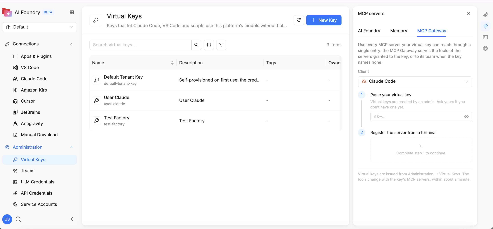

<!-- DRAFT for v15.2.1: review UI labels and screenshots against the release before publishing. -->

# MCP Gateway

The **MCP Gateway** gives external AI clients, such as **Claude** and **VS Code**, a single governed endpoint for the tools of every MCP server registered in AI Foundry. You configure the endpoint once in your client and authenticate with an AI Foundry **virtual key**. The client then sees the tools of every server the key is allowed to reach, and nothing else.

The MCP Gateway is part of the AI Gateway: the AI Gateway governs **which models** you call, and the MCP Gateway governs **which tools** you call.

## Key concepts

| Concept | Description |
| --- | --- |
| MCP server | A server registered in AI Foundry that exposes tools, resources and prompts through the Model Context Protocol. See [MCP Server](/products/ai-foundry/basic-concepts/14_mcp-server.md). |
| MCP Gateway | A single endpoint in front of all the registered MCP servers. It checks who is calling, forwards only the allowed calls and records them. |
| Virtual key | An AI Foundry credential used by external clients to authenticate to the gateway. A key grants access to a set of MCP servers. |
| Team key | A virtual key that belongs to a team. If it doesn't name any MCP servers, it reaches every server granted to the team. |

## How it works

1. **Grant access (admin).** A platform admin creates a virtual key, or uses a team's key, and chooses which MCP servers it can reach. A newly registered MCP server isn't reachable by any key until an admin grants it.
2. **Connect (user).** The user opens the connection page in AI Foundry, chooses their client and copies the ready-made configuration. When the client first starts, it asks for the virtual key. After that, the user sees only the tools of the servers granted to the key.
3. **Monitor (admin).** Calls made through the gateway are recorded with the key, the tool, the server, the client and the result.

The credentials of the MCP servers stay in AI Foundry: they are never sent to the client. Requests without a valid virtual key are rejected.

## Grant access to MCP servers

<!-- TODO: confirm the name of the MCP servers field in the virtual key form. -->

1. In the AI Foundry sidebar, go to **Administration → Virtual Keys** and click **New Key**, or select an existing key to edit it.
2. In the **MCP servers** field, select the servers the key can reach.
3. Save the key and share it securely with its users.

If you leave the **MCP servers** field empty on a team key, the key reaches every MCP server granted to that team.

:::caution
Grant only the servers the key's users actually need. The client acts with the key's permissions, which are shared by everyone who uses the key.
:::

## Connect a client

1. Open the **MCP servers** panel and select the **MCP Gateway** tab.
2. In **Client**, choose your client, for example **Claude Code**.
3. **Paste your virtual key.** Virtual keys are created by an admin: ask yours if you don't have one yet.
4. **Register the server from a terminal.** Once the key is pasted, the panel shows the command to run. Copy it and run it in a terminal.

The tools available in the client follow the MCP servers granted to the key: changes appear within about a minute.

## Choose the right entry

The **MCP servers** panel has three tabs:

| Tab | What it connects | How you sign in | What you see |
| --- | --- | --- | --- |
| AI Foundry | The AI Foundry MCP server | Your Mia-Platform account, on first connection | AI Foundry tools, one tenant at a time |
| Memory | The Memory MCP server | Your Mia-Platform account | Memory tools |
| MCP Gateway | Every MCP server granted to the virtual key | AI Foundry virtual key | The tools of those servers |

Pick the entry that matches what you need:

| If you need… | Use | Note |
| --- | --- | --- |
| Several servers, for example Atlassian or Catalog | MCP Gateway | One configuration and one key for all of them. You act with the key's permissions, and usage is recorded against the key. |
| To act as yourself in AI Foundry, for example to create agents or playbooks in your name | AI Foundry tab | Uses your personal permissions, one tenant at a time. |
| Memory | Memory tab | |

:::warning
Don't install the same MCP server twice. For example, avoid adding the AI Foundry tab and an MCP Gateway key that also grants **AI Foundry MCP**. Your client would show the same tools twice, with different permissions, and you couldn't tell which identity a call uses.
:::

## Limitations

- The gateway authenticates the **virtual key**, not the individual user: calls are recorded against the key.
- Access is granted per **MCP server**: a key that reaches a server can use all of that server's tools.
- Supported clients: Claude and VS Code.

## See also

- [MCP Server](/products/ai-foundry/basic-concepts/14_mcp-server.md): how MCP servers are registered in AI Foundry.
- [Third-party integrations](/products/ai-foundry/connections/20_third-party-integrations.md): use AI Foundry assets from your IDE.
- [Apps & Plugins](/products/ai-foundry/connections/10_apps-plugins.md): register the client applications that consume AI Foundry.
