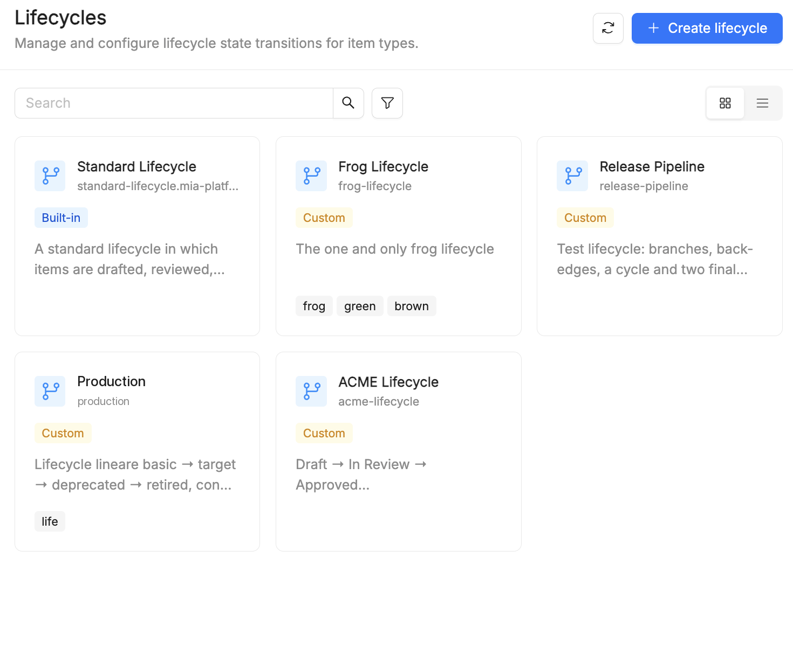
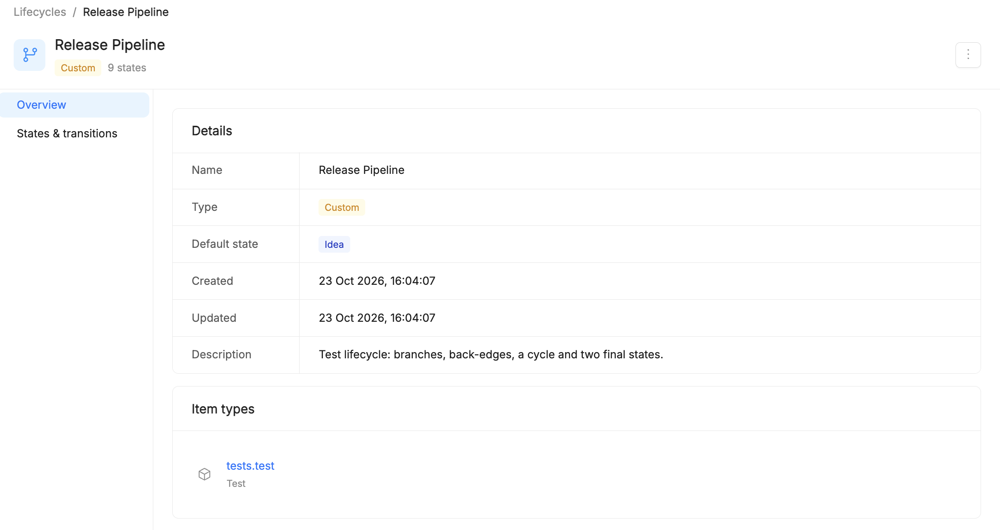
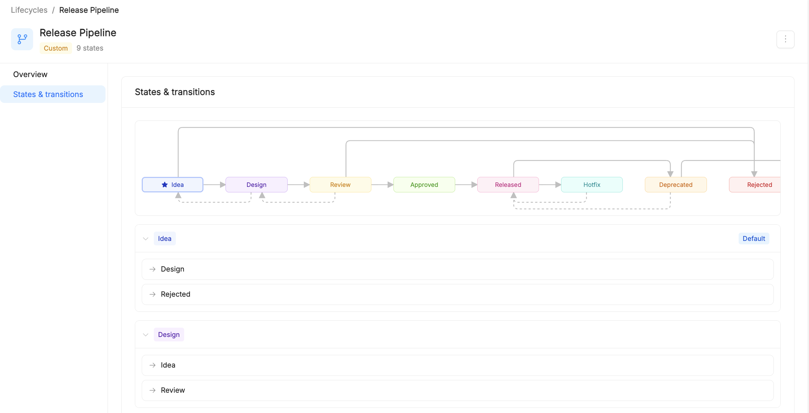
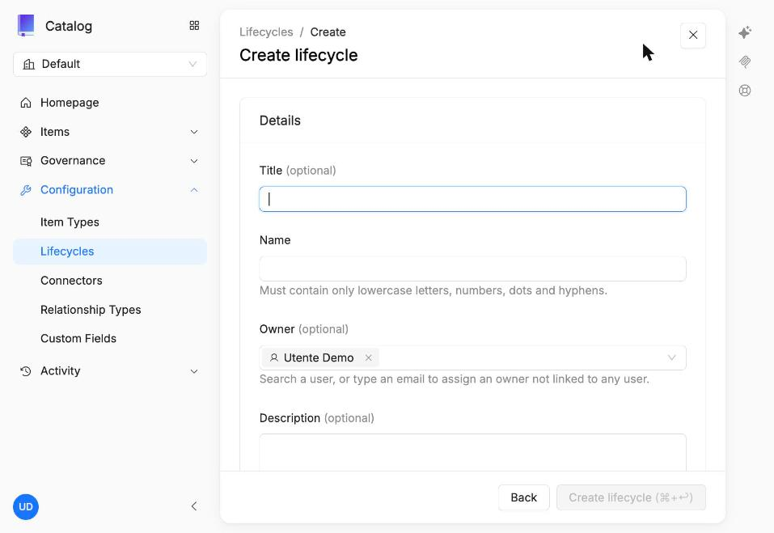
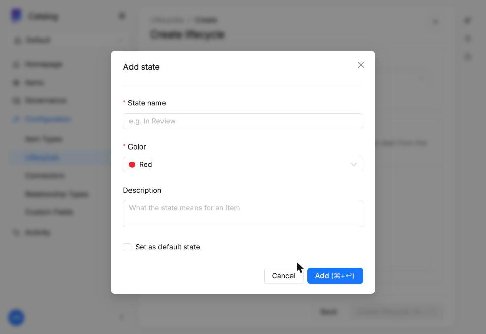
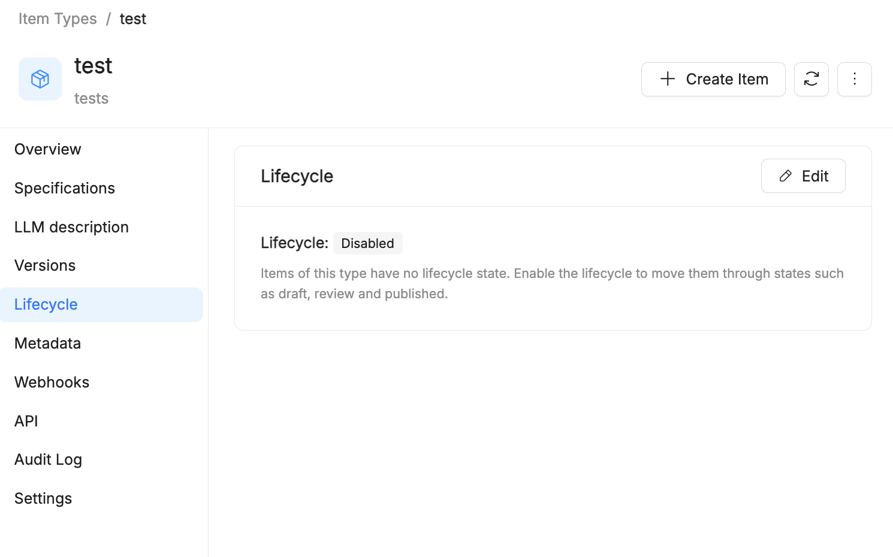
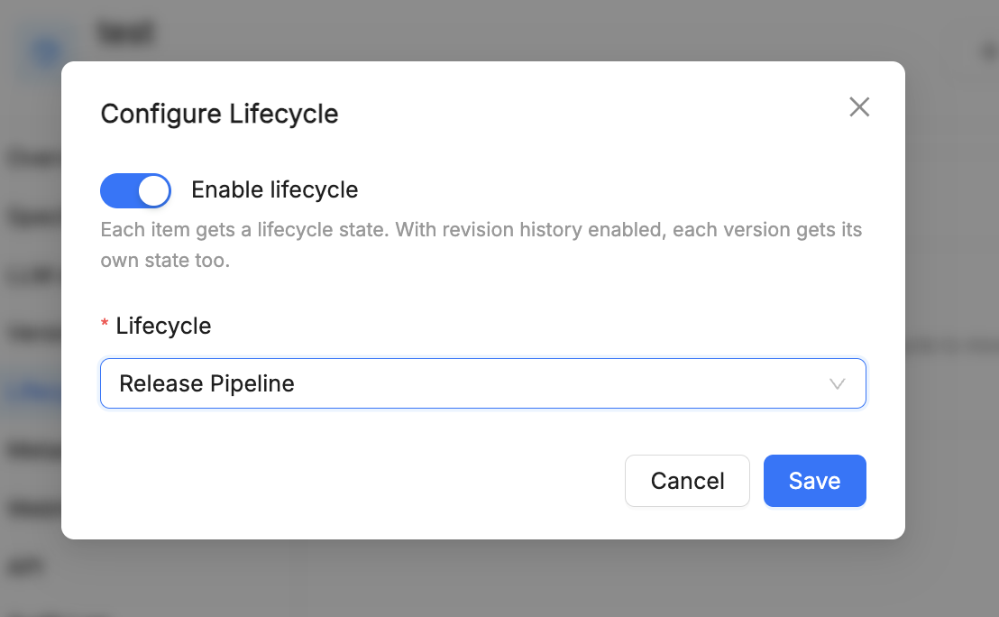
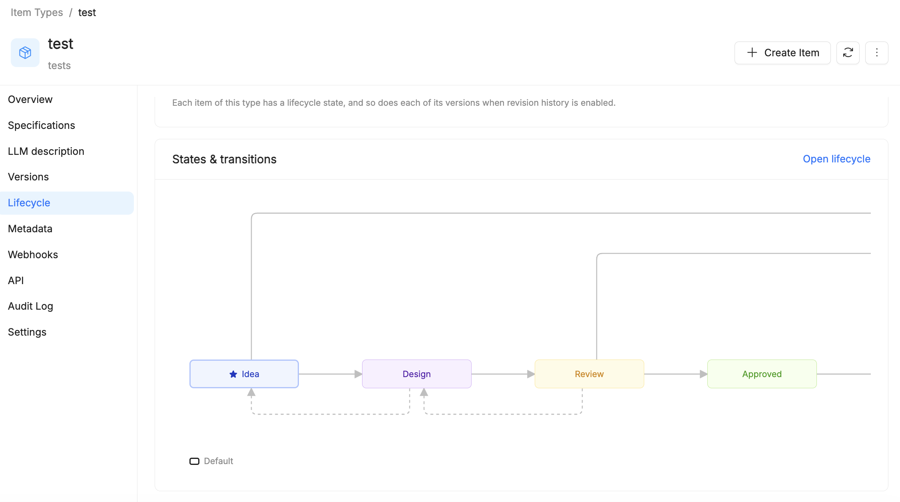
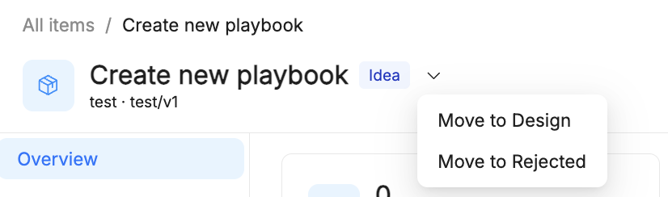

# Lifecycles

A **lifecycle** defines the states an [item](/products/catalog/basic-concepts/10_items.md) can go through and the transitions allowed between them. Lifecycles are associated with [Item Types](/products/catalog/basic-concepts/20_item-types.md): every item of that type starts in the lifecycle's default state and can move only along the transitions the lifecycle defines.

## Key concepts

| Concept | Description |
| --- | --- |
| State | A phase of the item, with a name, a color and an optional description |
| Default state | The state every new item starts from; one per lifecycle |
| Transition | An allowed move from one state to another; it is defined on the source state |
| Final state | A state with no outgoing transitions |
| Built-in | A lifecycle provided by the platform; it cannot be modified |
| Custom | A lifecycle created by the tenant, freely configurable (including branches, backward transitions and loops) |

## Browse lifecycles

Lifecycles are managed from **Configuration → Lifecycles**. The page lists every lifecycle of the tenant as a card with its title, name, description, tags and a **Built-in** or **Custom** badge. You can search and filter the list, and switch between grid and list view.

Among the available lifecycles you also find the built-in **Standard Lifecycle** (`standard-lifecycle.mia-platform.eu`), which takes items from Draft through review and publication to Archived.

Select a lifecycle to open its detail page, which has two sections:

- **Overview**: the lifecycle **Details** (name, type, default state, creation and last update dates, description) and the **Item types** that use it.
- **States & transitions**: a graph of the states and their transitions, with the default state marked by a star, followed by the list of states. Expand a state to see the states it can move to.

## Create a custom lifecycle

1. Go to **Configuration → Lifecycles** and click **Create lifecycle**.
2. Fill in the **Details**: Name (required; lowercase letters, numbers, dots and hyphens only), Title, Owner (user or email), and optionally Description and Tags.
3. In **States & transitions**, click **Add state** and set its name, color and description. Select **Set as default state** for the state new items start from.
4. For each state, add the outgoing transitions to the other states.
5. Save with **Create lifecycle** (⌘+↩).

## Associate a lifecycle with an Item Type

Lifecycles are configured for each Item Type Definition. By default the lifecycle of an Item Type is **Disabled** and its items have no lifecycle state.

1. Go to **Item Types**, open the Item Type and select **Lifecycle** in the side menu.
2. Click **Edit**.
3. In the **Configure Lifecycle** dialog, turn on **Enable lifecycle** and select the **Lifecycle** to use.
4. Click **Save**.

From then on, each item of that type has a lifecycle state. When revision history is enabled on the Item Type, each version of the item gets its own state too.

The **Lifecycle** section of the Item Type now shows the **States & transitions** graph of the selected lifecycle. Select **Open lifecycle** to go to its detail page.

:::caution
Changes to a lifecycle are not propagated to the items it is already assigned to: those items keep the lifecycle as it was when it was assigned.
:::

## Change the state of an item

Every item whose Item Type has a lifecycle shows its current state as a colored badge next to its name, in the item detail page. The menu next to the badge offers only the transitions allowed from the current state.

1. Open the item from **Items**, or from a filtered view.
2. Click the arrow next to the state badge.
3. Choose a **Move to &lt;state&gt;** action: only reachable states are listed.

The state is updated and the change creates a new revision of the item.

For example, an item in the **Idea** state of the *Release Pipeline* lifecycle offers two actions, **Move to Design** and **Move to Rejected**.

State changes can be traced from:

- **History**: the list of revisions, with date, editor and version. See [History and Item Versioning](/products/catalog/basic-concepts/65_item-history.md).
- **Audit Log**: the record of operations on the item, useful to find out who changed its state and when. See [Audit Logs](/products/catalog/basic-concepts/68_audit-logs.md).

Keep in mind that:

- A new item always starts from the default state of its lifecycle.
- No move is possible from a final state: the menu offers no actions.
- Backward transitions (e.g. Deprecated → Published) must be defined in the lifecycle, otherwise they are not available on items.

## Best practices

- Start from the Standard Lifecycle and create a custom one only when you need different states or rules.
- Always define at least one final state (e.g. Archived, Retired).
- Use consistent colors across lifecycles (e.g. green for published, gray for archived).
- Describe each state: explain what it means for the item and who moves it forward.
- Use backward transitions (e.g. In Review → Draft) to handle rejected reviews.
