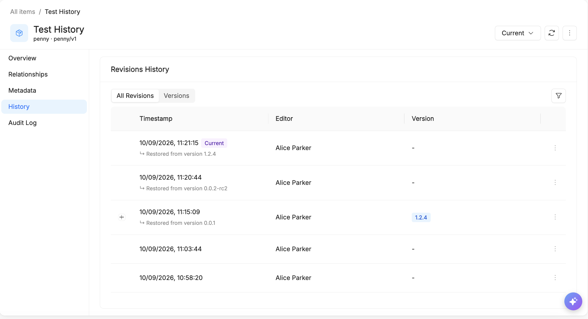
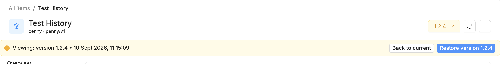
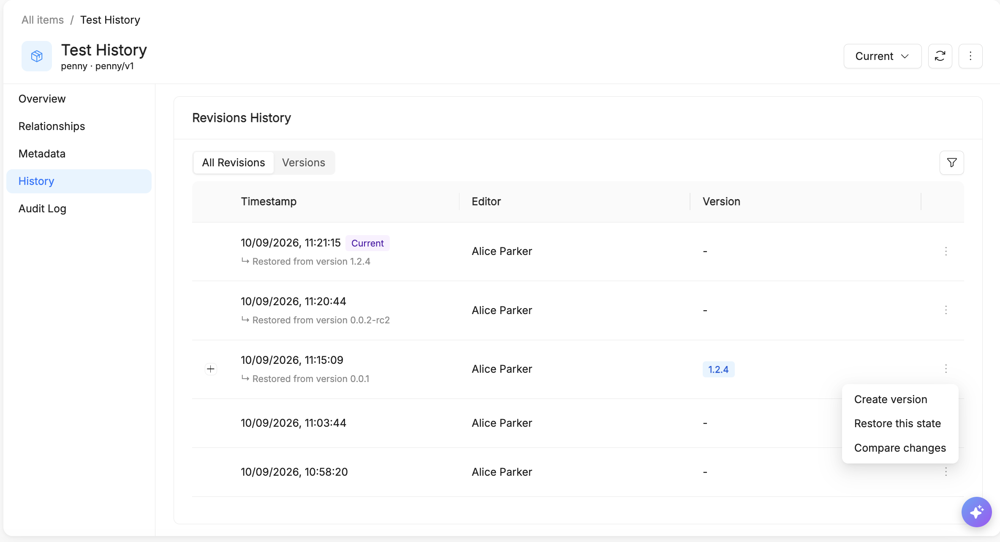
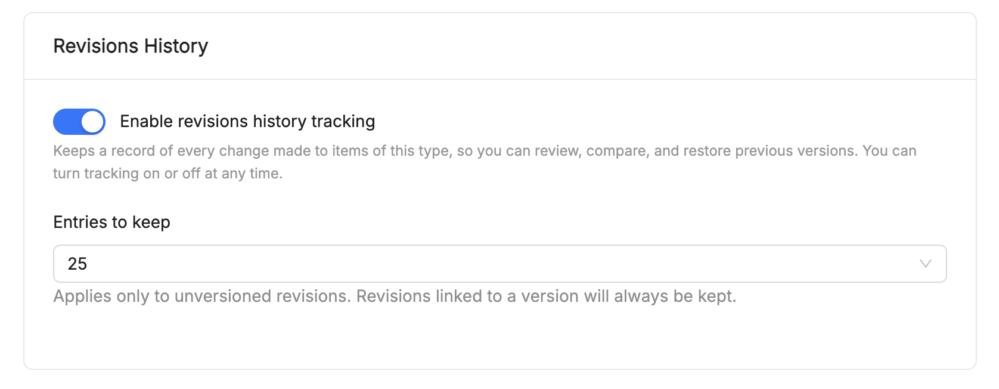
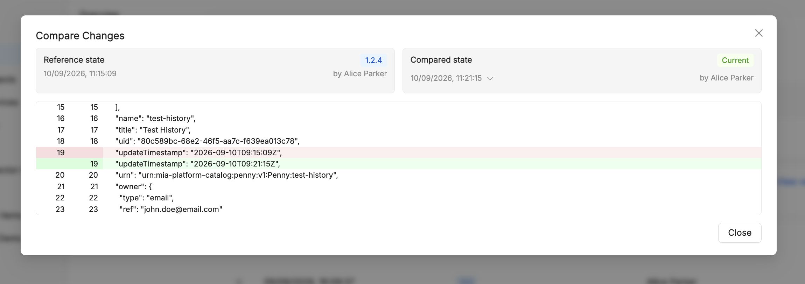

# History and Item Versioning

The **Item Versioning** feature in the Catalog lets you track changes to an [item](/products/catalog/basic-concepts/10_items.md) over time, compare revisions, browse its history, and roll back to a previous version.

## User interface and history management

Selecting an item in the Catalog opens its detail view, which includes a **History** section with two tabs:

- **All Revisions** — a continuous log of every save and change made to the item, showing its timestamp, editor, and the version it's linked to (if any).
- **Versions** — the subset of revisions that have been promoted and saved under a dedicated name (e.g. `1.2.4`), together with the author and, when provided, a description of that version.

The banner at the top right — showing **Current** by default — lets you switch to viewing any past version or revision. While viewing a non-current state, a banner shows which version/revision you're looking at and its timestamp, with shortcuts to go **Back to current** or **Restore** that state directly.

## Operations on versions

From the row actions menu (**⋮**) on an entry in **All Revisions** or **Versions**, the following actions are available:

- **Create version** — promote that revision to a named version.
- **Restore this state** — roll the item back to that revision or version.
- **Compare changes** — open a line-by-line diff against another state.

## Configurability per Item Type

Versioning is configured on the [Item Type](/products/catalog/basic-concepts/20_item-types.md) itself, under **Revisions History**:

- **Enable revisions history tracking** — a toggle that turns tracking on or off for every item of that type. It keeps a record of every change, so it can be reviewed, compared, and restored, and it can be switched on or off at any time.
- **Entries to keep** — how many revisions to retain (e.g. `25`). This limit applies only to **unversioned** revisions: any revision linked to a named version is always kept, regardless of this setting.

## Working with versions

### Creating a version

When you promote a revision to a version, the version **name** is mandatory, while the **description** is optional. Only users who can edit the item can create a version.

### Viewing a version

The version selector at the top lets you switch between **Current** and any version or revision. All the tabs of the item (Overview, Relationships, Metadata, History) show the state you selected, and its fields are read-only. **Back to current** brings you back to the current state of the item.

### Comparing versions

The **Compare Changes** dialog lets you pick a **Reference state** and a **Compared state** (each a specific version, revision, or Current) and shows the two JSON snapshots as a line-by-line diff, with changed lines highlighted. You can compare Current with a previous state, or two previous states with each other.

### Editing a version

You can change the name and the description of a version. Editing them changes only the version's metadata, never the content of the item it refers to.

Versions cannot be deleted.
