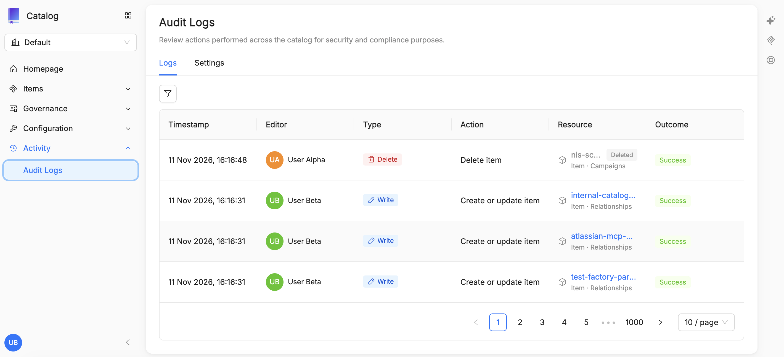
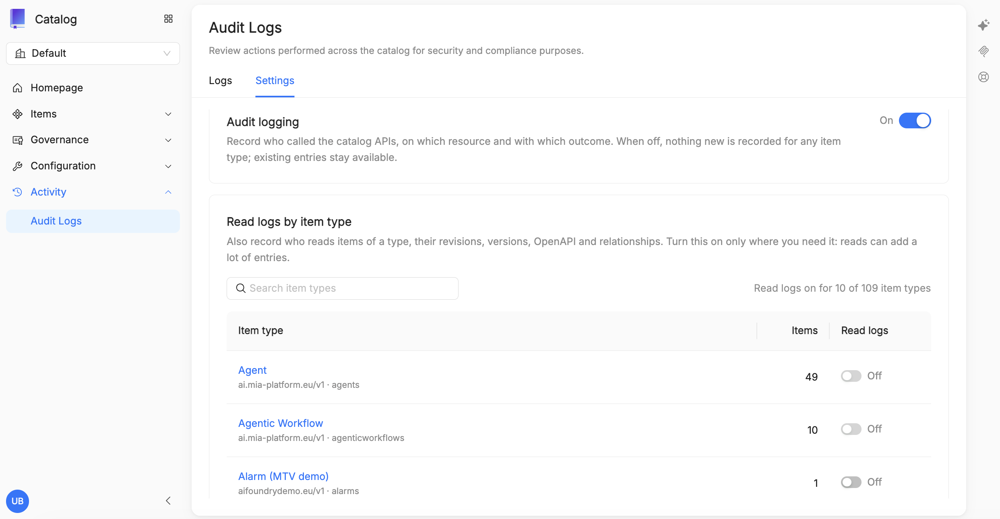
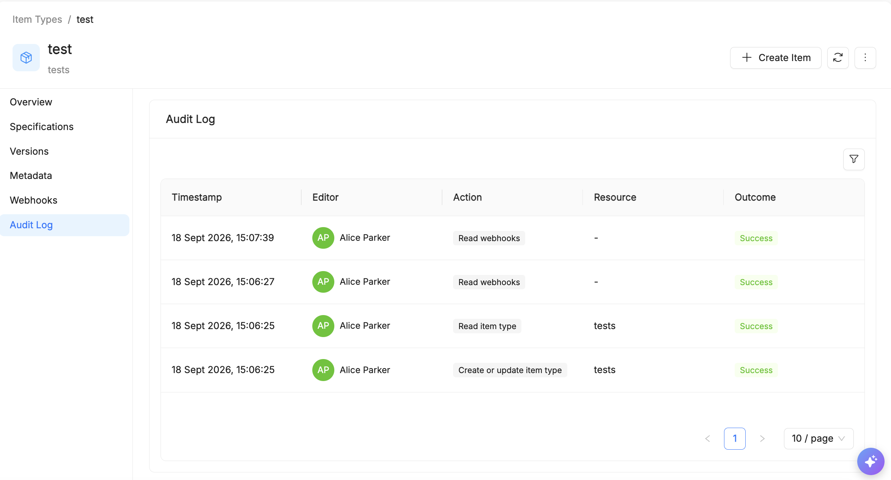

# Audit Logs

**Audit Logs** is the Catalog section, reachable from the side menu at **Activity > Audit Logs** within the currently selected tenant (shown at the top left, e.g. "Default"), that lets you review every action performed within the Catalog, for security and compliance purposes.

Viewing Audit Logs requires the **Auditor** role (see [Catalog roles](/products/mia-platform-suite/rbac_management.md#catalog-roles) in the RBAC documentation) — users without it, or another role that includes it, can't access either `Activity > Audit Logs` or the per-Item Type Audit Log tab described further down.

The page has two tabs: **Logs**, with the recorded events, and **Settings**, where you choose what gets recorded.

## Logs

Each row represents an event recorded by the system, sorted from most recent to least recent. For each event, the following columns are shown:

| Column | Description |
| :---- | :---- |
| **Timestamp** | Date and time the action occurred (e.g. `11 Nov 2026, 16:16:48`). |
| **Editor** | The user who performed the action, shown with initials/avatar and full name. |
| **Type** | The kind of operation: **Read**, **Write** (create or update) or **Delete**. |
| **Action** | The specific operation performed (e.g. *Create or update item*, *Delete item*). |
| **Resource** | The resource the action was performed on, with its kind and the area involved (e.g. *Item · Relationships*, *Item · Campaigns*). The name links to the resource; resources that no longer exist are marked **Deleted**. It may show "Unknown" when the action isn't tied to a specific object. |
| **Outcome** | The result of the operation: **Success** or **Error**. |

The list is paginated: use the controls at the bottom right to move between pages and choose how many entries to show per page.

### Filtering the logs

The filter icon above the table opens a panel to narrow down the list by **Time range** (a "From → To" date range), **Editor** (the user who performed the action), **Action** (from a granular list, e.g. *List item types, Read item type, Create or update item type, Delete item type, Read webhooks, Create or update item, Delete item, Read item OpenAPI, List item revisions, Create item version, Read/Update tenant settings*, and other governance and item-related actions), and **Outcome** (**Success** or **Error**).

### Example

An administrator wants to check who deleted items in the last week:

1. Open the filter panel.
2. Set the **Time range** to the last 7 days.
3. Select **Action = Delete item**.
4. *(Optional)* Select **Outcome = Error** to isolate only the failed attempts.
5. Review the results: deleted resources are marked **Deleted** in the **Resource** column.

## Settings

The **Settings** tab controls what the Catalog records for the current tenant.

### Audit logging

The **Audit logging** switch turns recording on or off for the whole tenant. When on, the Catalog records who called the catalog APIs, on which resource and with which outcome. When off, nothing new is recorded for any Item Type; entries already recorded stay available in the **Logs** tab.

### Read logs by item type

While audit logging is on, write operations (create, update, delete) are always recorded. Whether **read** operations are recorded too is a setting of each Item Type, managed from this table: when read logs are on for a type, the Catalog also records who reads items of that type, their revisions, versions, OpenAPI and relationships; when off, only write operations appear in the audit log.

The table lists every Item Type in the tenant, with its display name (linking to the Item Type), its API group, version and plural (e.g. `ai.mia-platform.eu/v1 · agents`), the number of **Items** of that type, and the **Read logs** switch. Use the search field to find a type, while the counter on the right shows for how many types read logs are on (e.g. *Read logs on for 10 of 109 item types*).

Turn read logs on only where you need them: reads are typically much more frequent than writes and would otherwise flood the audit log. For this reason read logs are **off by default**, except for the AI Foundry Item Types (e.g. agents, agentic workflows), for which audit logging, reads included, is **on by default**.

## Notes

- The **Resource** column can show "Unknown" for some actions (e.g. reading tenant settings), since they are not associated with a specific object.
- Recorded actions cover both read and write operations on items, item types, versions, revisions, relationships, webhooks, and tenant settings.

## Audit log of an Item Type and of an item

Audit logs are recorded per item: besides the tenant-wide `Activity > Audit Logs` view, you can see the history of a single resource from its own page.

- **Item Type**: each [Item Type](/products/catalog/basic-concepts/20_item-types.md) has an **Audit Log** tab, showing the same kind of events (Timestamp, Editor, Type, Action, Resource, Outcome) filtered to that type and its items.
- **Item**: opening an item and its audit log section shows the events recorded for that item only.

Which events appear here follows the [Settings](#settings) above: nothing new is recorded while audit logging is off, and reads appear only for Item Types with read logs on.
