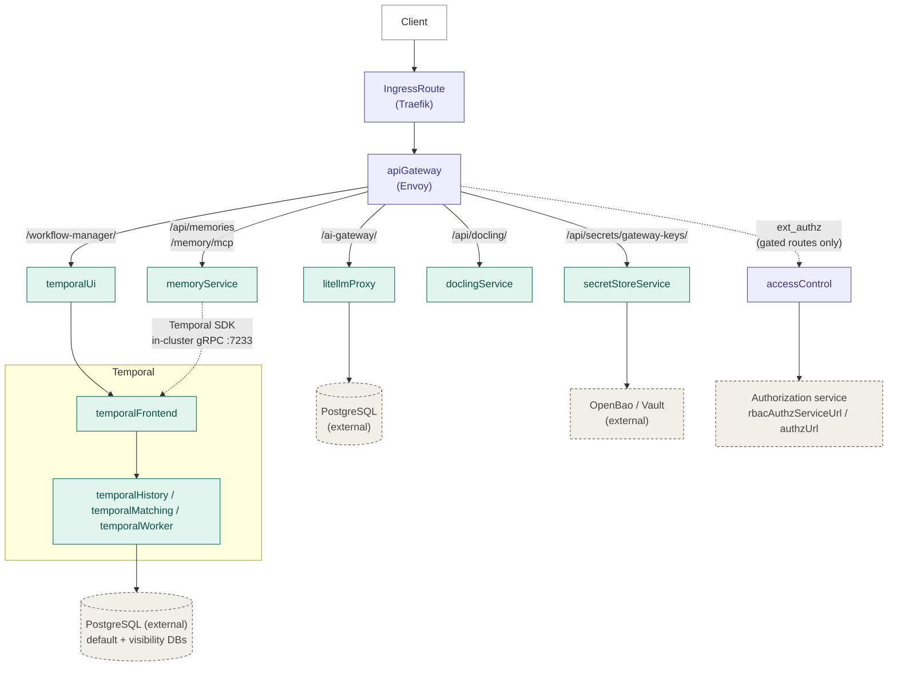
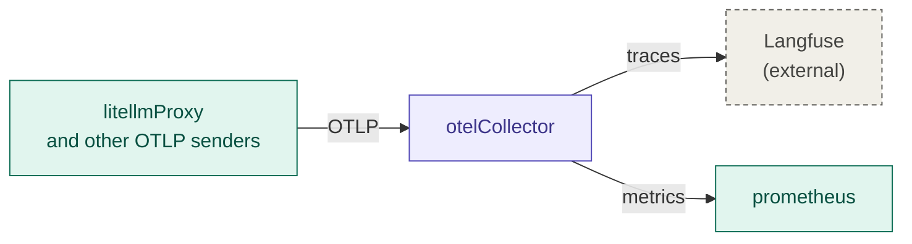

# AI Services

Mia Platform **AI Services** is the shared, cross-tenant AI infrastructure of the platform. It is the layer that AI Foundry (the application layer) calls into: every model call goes through its AI gateway, so cost, quotas and per-key credentials are managed in one place. It also hosts the workflow engine, document conversion and long-term memory services that several products share.

The `ai-services` chart deploys the following building blocks:

- **LiteLLM Proxy**: the AI gateway. It authenticates callers with its own virtual keys, not with the platform JWT.
- **Temporal**: the workflow engine, deployed as a split-service cluster (frontend, history, matching and internal worker, each independently scalable).
- **Envoy API gateway**: a single HTTP entry point in front of LiteLLM Proxy, the Temporal Web UI, Docling and Memory.
- **Access Control**: the platform `ext-authz` service with an in-process OPA, running the product's own `ai_services` policy bundle.
- **Docling**: document conversion.
- **Memory**: long-term memory owned by a person and shareable with named colleagues, exposed through a REST API and an MCP endpoint.
- **OpenTelemetry Collector** and **Prometheus** *(optional)*: the telemetry pipeline. The collector receives OTLP and sends traces to Langfuse, installed outside this chart, and metrics to Prometheus.

## What the chart deploys

| Component | Image | Description |
|---|---|---|
| **apiGateway** | `cache/envoyproxy/envoy` | Envoy reverse proxy. Routes all inbound traffic. When `authorizationServer.enabled` is `true` it validates JWTs (`jwt_authn`), and when `accessControl.enabled` is `true` it delegates authorization of the gated routes to `accessControl` (`ext_authz`). |
| **accessControl** | `platform/auth/access-control/ext-authz` | *(Disabled by default.)* OPA-based ext-authz service called by the API gateway. Loads the `ai_services` policy bundle shipped with the chart. |
| **litellmProxy** | `berriai/litellm` | LiteLLM Proxy, the AI gateway. Stores virtual keys, spend and registered models in an external PostgreSQL database. Runs with an `nginxinc/nginx-unprivileged` sidecar that serves the curated model cost map (`litellmProxy.modelCostMap`). |
| **doclingService** | `docling-project/docling-serve-cpu` | Document conversion service, reachable at `/api/docling/` through the API gateway. |
| **memoryService** | `ai-services/memory-service` | *(Disabled by default.)* Long-term memory service. Needs a PostgreSQL database of its own with the `vector` extension. Exposed at `/api/memories` (REST) and `/memory/mcp` (MCP) through the API gateway. |
| **secretStoreService** | `ai-resources/secret-store-service` | *(Disabled by default.)* Stores the tenants' LiteLLM virtual keys (the `gateway-keys` collection) in an external OpenBao or Vault store. Reachable only at `/api/secrets/gateway-keys/{key}` through the API gateway. |
| **otelCollector** | `otel/opentelemetry-collector-contrib` | *(Disabled by default.)* OpenTelemetry Collector that sends traces to an external Langfuse and metrics to Prometheus. |
| **prometheus** | `prom/prometheus` | *(Disabled by default.)* Prometheus with the OTLP receiver enabled. Not routed by the API gateway. |
| **temporalFrontend**, **temporalHistory**, **temporalMatching**, **temporalWorker** | `temporalio/server` | Temporal server, one Deployment per role. `temporalWorker` is Temporal's internal system worker, not the place where application workflows run. |
| **temporalUi** | `temporalio/ui` | Temporal Web UI, served at `/workflow-manager/` through the API gateway. |
| **temporalAdminTools** | `temporalio/admin-tools` | `temporal` CLI pod for operational tasks (`kubectl exec`). Not exposed by any route. The same image runs the `temporal-schema-setup` (pre-install/pre-upgrade) and `temporal-namespace-setup` (post-install/post-upgrade) Jobs. |

:::info
Langfuse and OpenBao are not deployed by this chart: install them with their official Helm charts on Kubernetes, or in any other way their official guides support. See [Langfuse and OpenBao](/requirements/installation-guidelines/shared-services/ai-services/20_langfuse-and-openbao.md).
:::

:::info
Not every image comes from the Mia Platform registry. The default `image.registry` of each component is `nexus.mia-platform.eu` for the Mia Platform images, `docker.litellm.ai` for LiteLLM, `quay.io` for Docling and `docker.io` for the other third-party images. When a component's `image.registry` is empty, `global.imageCredentials.registry` is used instead.
:::

The chart does not deploy a PostgreSQL database for any component, and it does not include Kafka.

## Architecture overview

When the optional telemetry pipeline is enabled, it stays inside the cluster and has no route on the API gateway:

Routes and their authentication chain:

| Route | Chain |
|---|---|
| `/api/docling/` | `jwt_authn` + `ext_authz` |
| `/api/memories`, `/memory/mcp` | `jwt_authn` + `ext_authz` |
| `/api/secrets/gateway-keys/{key}` | `jwt_authn` + `ext_authz` |
| `/.well-known/oauth-protected-resource/memory/mcp` | Public (MCP protected-resource metadata) |
| `/ai-gateway/` | Public. LiteLLM authenticates every call with its own virtual key. |
| `/workflow-manager/` | Public at the gateway. The Temporal UI can run its own OIDC login (`temporalUi.auth`). |

Every route under `litellmProxy.basePath` is public, including LiteLLM's admin API and web UI: the LiteLLM master key (`secrets.litellmProxyKeys.masterKey`) is the only credential that protects the admin API, so treat it as an internet-facing password.

The Temporal gRPC frontend does not go through Envoy. It stays cluster-internal on the `temporal-frontend` Service, port `7233`, which is how Temporal SDK workers connect. Temporal has no mTLS and no authorizer configured between its services in this chart, so this port is never published.

The chart refuses to render the gated components (`doclingService`, `memoryService`, `secretStoreService`) unless both `authorizationServer.enabled` and `accessControl.enabled` are `true`, and it refuses an empty `apiGateway.authorizationServer.audiences`, because the services behind these routes do not verify tokens themselves.

## Authorization context integration

When `accessControl.enabled` is `true`, `accessControl` resolves the caller's external context against the platform authorization service configured with `rbacAuthzServiceUrl` (gRPC, preferred) or `authzUrl` (HTTP), typically the `services` chart's API gateway. It authenticates to that service as its own OIDC client (`accessControl.config.externalContext.authorization.clientId`, default `ai-services-access-control`) with `private_key_jwt`. The private key stays in the pod: `accessControl` publishes the matching public key, and `apiGateway` re-publishes it at `<url>/.well-known/jwks.json`, where Keycloak fetches it. The URL configured for AI Services in the realm must therefore match the chart's `url`, otherwise every token request from `accessControl` fails.

The gated routes accept only tokens issued for the AI Services audience (`apiGateway.authorizationServer.audiences`, `["ai-services-api"]` on a Mia-Platform installation). Such tokens are obtained by a product backend through token exchange, or by an MCP client through OAuth with the `mia:ai-services` scope.

## Relationships with other Mia Platform products

| Product / System | Integration | Configuration key |
|---|---|---|
| **Keycloak** | OIDC issuer for `jwt_authn`, for `accessControl`'s service-account client and for the optional Temporal UI login. The realm needs the `ai-services-access-control` client, the `ai-services-api` audience client with the `mia:ai-services` client scope, and, when `temporalUi.auth.enabled` is `true`, a confidential client for the Temporal UI. The Realm Management chart (`0.1.47` or later) creates the `ai-services-access-control`, `ai-services-api` and `ai-services-temporal-ui` clients when `products.aiServices` is enabled. | `authorizationServer.issuer`, `accessControl.config.externalContext.authorization.*`, `temporalUi.auth.*` |
| **Homepage & RBAC (`services`)** | Authorization service used by `accessControl` to resolve the caller's external context. | `rbacAuthzServiceUrl`, `authzUrl` |
| **AI Foundry** | AI Foundry calls AI Services, and AI Services never calls AI Foundry. AI Foundry's components send model calls through LiteLLM Proxy, read the model cost map served by LiteLLM, call Docling and Memory, and use Temporal for workflows. AI Foundry's backend writes each tenant's LiteLLM virtual key to `secretStoreService`, and every `adk-be-app` reads it from there. | `url`, `litellmProxy.*`, `secretStoreService.*` |
| **Catalog** | Products that chat through the AI gateway, the Catalog included, read the same tenant virtual key from `secretStoreService`. The `gateway-keys` route accepts tokens exchanged by the products' token-exchange clients, `catalog-token-exchange` included. | `secretStoreService.*` |
| **PostgreSQL** | External databases for LiteLLM Proxy, Temporal (default and visibility stores) and Memory (with the `vector` extension). | `secrets.litellmProxyKeys`, `secrets.temporalKeys`, `secrets.memoryServiceKeys` |
| **OpenBao / Vault** | Secret store behind `secretStoreService`: an external OpenBao or Vault (`secretStoreService.config.storeAddr`), installed with its official chart or guides. See [Langfuse and OpenBao](/requirements/installation-guidelines/shared-services/ai-services/20_langfuse-and-openbao.md). | `secretStoreService.config.*` |
| **Langfuse** | Trace store for AI observability, installed with its official chart or guides. `otelCollector` exports traces to it over OTLP, and AI Foundry reads them. See [Langfuse and OpenBao](/requirements/installation-guidelines/shared-services/ai-services/20_langfuse-and-openbao.md). | `otelCollector.config.langfuse.*`, `secrets.otelCollectorKeys` |
| **OpenTelemetry** | LiteLLM Proxy exports traces and GenAI metrics over OTLP to the endpoint resolved from `litellmProxy.telemetry.otlpEndpoint`, the in-chart `otelCollector` or `telemetry.otelExporterOtlpEndpoint`. | `telemetry.*`, `litellmProxy.telemetry.*` |
| **MCP-compatible AI tools** | `memoryService` exposes an MCP endpoint at `/memory/mcp`. Clients discover the authorization server from `/.well-known/oauth-protected-resource/memory/mcp` and authenticate as one of the MCP clients registered in the realm (Claude Code, Visual Studio Code). | `memoryService.config.mcpEnabled` |

Refer to the following installation guides to set up the required dependencies before installing AI Services:

- [Keycloak installation guide](/requirements/installation-guidelines/shared-services/authn/keycloak/15_getting-started.md)
- [Realm Management guide](/requirements/installation-guidelines/shared-services/authn/keycloak-realm-management/15_getting-started.md)
- [Homepage & RBAC guide](/requirements/installation-guidelines/shared-services/services/15_getting-started.md)

## Deployment models

| Model | When to use |
|---|---|
| **Standalone chart** | Install the `ai-services` chart directly with a custom `values.yaml`. Suitable for single-environment setups. |
| **`ai-services-deployment` wrapper** | Use the wrapper repository that declares the chart as a Helm dependency with the `aiServices` alias and provides per-environment values files (`values/production.yaml`, `values/development.yaml`, etc.). All chart values are nested under the `aiServices:` key. Recommended for multi-environment GitOps workflows. |
