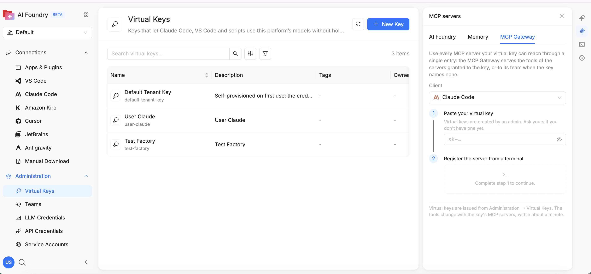

{/* DRAFT: confirm the release date, the Helm chart versions and the bill of materials before publishing. */}

_TBD_

## Catalog

### API Reference

Items and Item Types now include auto-generated OpenAPI documentation, always in sync with the schema — see the official [Items](/docs/15.2.1/products/catalog/basic-concepts/items#api-reference) and [Item Types](/docs/15.2.1/products/catalog/basic-concepts/item-types#api-reference) documentation.

## AI Foundry

### Versioning

Agents, playbooks, prompts, skills and tools now have a **History** section to compare, promote and restore revisions — see the official [Item Versioning documentation](/docs/15.2.1/products/catalog/basic-concepts/item-history#ai-foundry-resources).

  

  

### MCP Gateway

The new **MCP Gateway** exposes the tools of all registered MCP servers to external AI clients through a single governed endpoint, while credentials stay in AI Foundry — see the official [MCP Gateway documentation](/docs/15.2.1/products/ai-foundry/connections/mcp-gateway).

  

  

## How to update

To move from Mia-Platform v15.2.0 to v15.2.1, update the Helm charts listed below. Products not listed here stay on the chart versions of the previous release notes. For the complete installation sequence, see the [Installation Guidelines](/docs/15.2.1/requirements/installation-guidelines/overview).

### Helm chart versions

{/* TODO: fill in the chart versions released with v15.2.1. */}

| Product | Helm Chart | Version | Upgrade guide |
|---|---|---|---|
| **Catalog** | `catalog` | `TBD` | [How to upgrade](/docs/15.2.1/requirements/installation-guidelines/catalog/how-to-upgrade) |
| **AI Foundry** | `ai-foundry` | `TBD` | [How to upgrade](/docs/15.2.1/requirements/installation-guidelines/ai-foundry/how-to-upgrade) |

### Upgrade notes

#### Catalog: from 0.5.3 to TBD

TBD

#### AI Foundry: from 0.5.0-preview.4 to TBD

TBD

### Bill of materials

{/* TODO: add one 
 block per chart, as in the v15.2.0 release notes. */}
