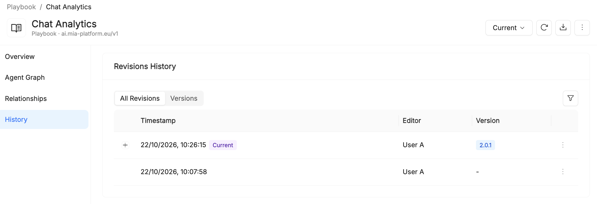

{/* DRAFT: confirm the release date, the Helm chart versions and the bill of materials before publishing. */}

_TBD_

## Catalog

### Lifecycles

Items can now follow a **Lifecycle**: a set of states, such as Draft, In Review, Published and Archived, and the transitions allowed between them. Lifecycles are managed from **Configuration > Lifecycles**, where you find the built-in **Standard Lifecycle** and can create custom lifecycles with branches, backward transitions and loops. Once a lifecycle is associated with an Item Type, every new item of that type starts in the default state and can move only along the allowed transitions. See the official [Lifecycles documentation](/docs/products/catalog/basic-concepts/lifecycles) to discover all the available features.

### API Reference for items and Item Types

Every item and every Item Type Definition now has an **API** section in its detail page, with its OpenAPI documentation generated automatically by the Catalog and always in sync with the Item Type schema. The section lists every available operation with paths already resolved, and **Download OpenAPI** lets you import the specification into an API client, generate a client SDK, or give it to an AI agent as the item's contract. See the [Items](/docs/products/catalog/basic-concepts/items#api-reference) and [Item Types](/docs/products/catalog/basic-concepts/item-types#api-reference) documentation.

## AI Foundry

### Item Versioning

AI Foundry resources, such as agents, playbooks, prompts, skills and tools, now have the same **History** section as Catalog items: browse all revisions, promote a revision to a named version, compare two states with a line-by-line diff and restore a previous one. History tracking is **always on by default** for AI Foundry resources. See the official [Item Versioning documentation](/docs/products/catalog/basic-concepts/item-history#ai-foundry-resources).

### MCP Gateway

The new **MCP Gateway** gives external AI clients, such as **Claude Code** and **VS Code**, a single governed endpoint for the tools of every MCP server registered in AI Foundry. Admins grant MCP servers to a **virtual key** from **Administration > Virtual Keys**; users open the **MCP Gateway** tab of the **MCP servers** panel, paste their key and register the server with one command. The client then sees only the tools of the servers granted to the key, while the servers' credentials never leave AI Foundry. See the official [MCP Gateway documentation](/docs/products/ai-foundry/connections/mcp-gateway).

## How to update

To move from Mia-Platform v15.2.0 to v15.2.1, update the Helm charts listed below. Products not listed here stay on the chart versions of the previous release notes. For the complete installation sequence, see the [Installation Guidelines](/docs/requirements/installation-guidelines/overview).

### Helm chart versions

{/* TODO: fill in the chart versions released with v15.2.1. */}

| Product | Helm Chart | Version | Upgrade guide |
|---|---|---|---|
| **Catalog** | `catalog` | `TBD` | [How to upgrade](/docs/requirements/installation-guidelines/catalog/how-to-upgrade) |
| **AI Foundry** | `ai-foundry` | `TBD` | [How to upgrade](/docs/requirements/installation-guidelines/ai-foundry/how-to-upgrade) |

### Upgrade notes

#### Catalog: from 0.5.3 to TBD

TBD

#### AI Foundry: from 0.5.0-preview.4 to TBD

TBD

### Bill of materials

{/* TODO: add one 
 block per chart, as in the v15.2.0 release notes. */}
